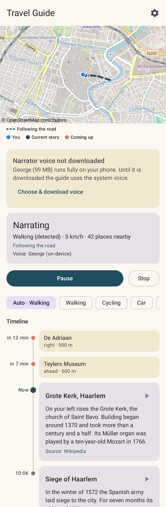
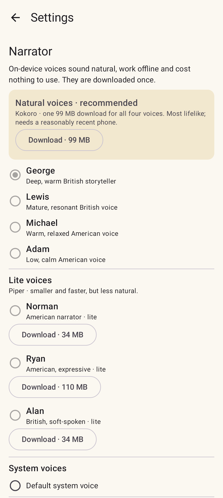

# Travel Guide

An Android audio companion that tells you about the places you travel through: their history,
landscape, nature and culture. It speaks in a calm, deep narrator voice that runs entirely on
your phone.

> **Status: proof of concept.** The guide works end to end (location → stories → voice), but
> expect rough edges. See the [roadmap](#roadmap).

## Screenshots

<p>
  
  
</p>

_Rendered from the current `main` after every merge, with sample content. Map © OpenStreetMap
contributors._

## What it does

- **Narrates your surroundings** from geotagged Wikipedia articles: towns you enter, rivers you
  cross, castles on the hill.
- **A walking tour of any town.** On foot it also tells about the town itself and the buildings
  and institutions you pass: the town hall, churches, museums, the university, listed monuments.
  This includes places without their own Wikipedia article: their facts come from
  [OpenStreetMap](https://www.openstreetmap.org/) and [Wikidata](https://www.wikidata.org/)
  ("It was built in 1488. Today it is protected as a Rijksmonument, a listed national
  monument."). Free sources, no API key.
- **Looks ahead.** It predicts where you will be in the next few minutes. With a planned route
  it follows that route; otherwise it extends your current heading. It tells you about what is
  *coming up* rather than what you just passed, and says on which side it is.
- **Follows your route.** Share directions from Google Maps, a Komoot tour, or a GPX/FIT file
  (e.g. a Garmin course export) with the app, and the stories follow that route. With optional
  notification access it also shows when Google Maps, Komoot, Garmin, OsmAnd or Waze is
  navigating. See [following routes](#following-a-route-from-a-navigation-app).
- **Adapts to how you travel.** The speed decides the detail level:

  | Mode | Looks for | Search radius | Look-ahead | Story length |
  |---|---|---|---|---|
  | Walking | buildings, landmarks, streets | 1 km | 2 min | up to 6 sentences |
  | Cycling | landmarks, villages | 2.5 km | 3 min | up to 5 sentences |
  | Car | towns, rivers, hills | 10 km | 5 min | up to 4 sentences |
  | Train | towns, regions, landscape | 10 km | 5 min | up to 3 sentences, "out of the left-hand window" |
  | Plane | regions, mountains, lakes | 10 km | 10 min | up to 2 sentences |

  The mode is detected from your speed (with hysteresis against GPS glitches). You can also pick
  it yourself, because car and train speeds overlap.
- **Soothing on-device voice.** Natural [Kokoro](https://huggingface.co/hexgrad/Kokoro-82M)
  voices (default: George, a deep, warm British storyteller) and lighter Piper voices run with
  [sherpa-onnx](https://github.com/k2-fsa/sherpa-onnx). They are free and work offline. Any
  Android system voice works too. See the [voice research](docs/voice-research.md), and listen to
  every voice on the [voice samples](../../releases/tag/voice-samples) page.
- **Stories, not statistics.** The guide reads the whole article and tells the best bits: where
  the name comes from, legends, history and culture. History comes first; plain municipalities
  and population figures come last.
- **Stories that connect.** Looking ahead along the route, it weaves nearby places, and places the
  article mentions, into one story.
- **A timeline of what's coming.** The screen shows upcoming stories with their expected time,
  the current story, and earlier ones.
- **A map of the stories.** An OpenStreetMap view shows you, the places of the current story and
  the ones coming up. The road ahead is solid when it comes from navigation and dashed when it is
  guessed from your movement.
- **Pauses when it should.** Phone and VoIP calls and navigation prompts (e.g. Google Maps
  saying "turn left") pause the guide, and it resumes the sentence afterwards. Music is ducked
  while the guide speaks.
- **Pause from anywhere.** Use the media controls in the notification shade, the lock screen,
  Bluetooth/headset buttons or the **Quick Settings tile**.
- **No paid AI at runtime.** Stories come from Wikipedia text with hand-written phrasing, so
  there are no API costs.
- **Optionally, Claude retells the stories.** With your own Anthropic API key (Settings → Stories),
  Claude retells each story from its Wikipedia article, keeping to its facts. You choose the model
  and a monthly budget; a place is paid for only once, and on any problem you hear the built-in
  story. The key is stored encrypted with the Android Keystore and only sent to the Anthropic API.

## Install

Download the latest APK:

- **Stable**: the [latest release](../../releases/latest).
- **Alpha**: the newest `v…-alpha.N` [pre-release](../../releases). Every merge to `main` is
  tagged and published as one.
- **A pull request**: follow the "Test build ready" comment on the PR (the APK artifact of its
  *Android* run).

Enable "Install unknown apps" for your browser or file manager, open the APK, start the app and
tap **Start guiding**. On first use, open **Settings → Narrator** and download the natural voices
(99 MB).

Newer builds (releases, alpha and pull-request builds alike) install over the old version and
keep your voices and settings. Builds from before stable signing ([#15](../../issues/15)) can't be
updated: uninstall such an older build once, then install the new one.

## Following a route from a navigation app

Share the route with **Follow route in Travel Guide** in the share sheet, then tap **Start
guiding** (sharing while the guide runs works too):

- **Google Maps**: plan directions, then **⋮ → Share directions**. Google offers no route data,
  so the route is recomputed with OpenStreetMap (OSRM) and may differ slightly.
- **Komoot**: share the tour link. For a private tour, export it as GPX in Komoot and share the
  file. Komoot tours are read through an unofficial endpoint that may change.
- **Garmin Connect / Explore**: course links need a login, so export the course as GPX (or FIT)
  and share the file, or import it in **Settings → Navigation → Import GPX file**.
- **Any other app** (OsmAnd, Strava, route planners): share or open a GPX file.

The status card and the map legend show where the route came from. See
[docs/navigation.md](docs/navigation.md) for details, limits and privacy.

## How it works

```
GPS fixes ─▶ MotionTracker ─▶ travel mode, speed, heading
                                │
               RouteExtrapolator (planned route or dead reckoning)
                                │  predicted path
Wikipedia geosearch ─┐
OSM buildings + Wikidata (walking) ─┴▶ PoiScorer (prominence × interest × geometry × mode weights)
                                │  best place
                     NarrationComposer (opener + cleaned article sentences)
                                │
                  Narrator (Piper via sherpa-onnx, or system TTS) ─▶ 🔊
```

| Module | Contents |
|---|---|
| `core/` | Pure Kotlin, no Android: geo math, motion detection, route prediction, scoring, Wikipedia, Wikidata and OpenStreetMap clients, narration text, route import (GPX/FIT, Google Maps/Komoot/Garmin links, OSRM, Nominatim). Fast JVM unit tests. |
| `app/` | Android app (Kotlin, Jetpack Compose): foreground service, location, audio focus, media session, notification, Quick Settings tile, voice download and playback, route sharing and navigation notifications. |

## Develop

Requirements: JDK 17+ (Gradle 9 and AGP 9 need at least 17; CI uses 21), and for the app the
Android SDK with platform API 37 and build tools 36.

```bash
# Core logic only; needs no Android SDK
./gradlew :core:test -PcoreOnly=true

# Full app
scripts/fetch-sherpa-onnx.sh      # downloads the TTS runtime into app/libs (once)
./gradlew :app:assembleDebug
```

See [CONTRIBUTING.md](CONTRIBUTING.md) for the workflow (feature branches, Conventional Commits,
changelog, CI).

### CI

- **CI** runs the JVM core tests on each PR (about a minute, no Android SDK).
- **Android** builds and lints the app when app-related files change in a PR; PRs get an APK
  artifact. Every merge to `main` is tagged `v<appVersion>-alpha.N` and published as a
  pre-release with its APK, and the README screenshots are re-rendered (see CONTRIBUTING.md).

## Roadmap

Planned features are tracked as [issues](../../issues), such as voice choice and
Dutch narration, interest selection, start suggestions and climate facts.

## Credits

- Place information: [Wikipedia](https://www.wikipedia.org/) contributors, under
  [CC BY-SA 4.0](https://creativecommons.org/licenses/by-sa/4.0/). The app links every story to
  its source article.
- Buildings and institutions: © [OpenStreetMap](https://www.openstreetmap.org/copyright)
  contributors (ODbL), read through the [Overpass API](https://overpass-api.de/), and
  [Wikidata](https://www.wikidata.org/) (CC0). The town you are in is found with
  [Nominatim](https://nominatim.org/).
- Map: © [OpenStreetMap](https://www.openstreetmap.org/copyright) contributors, displayed with
  [osmdroid](https://github.com/osmdroid/osmdroid) (Apache 2.0).
- Routing for shared Google Maps links: [OSRM](https://project-osrm.org/) on the FOSSGIS servers
  (routing.openstreetmap.de) and [Nominatim](https://nominatim.org/), with OpenStreetMap data.
- Speech: [sherpa-onnx](https://github.com/k2-fsa/sherpa-onnx) (Apache 2.0) with
  [Piper](https://github.com/rhasspy/piper) voices (see each voice's model card for its license).

## License

[Apache License 2.0](LICENSE). Wikipedia content and voice models keep their own licenses (see
Credits).
